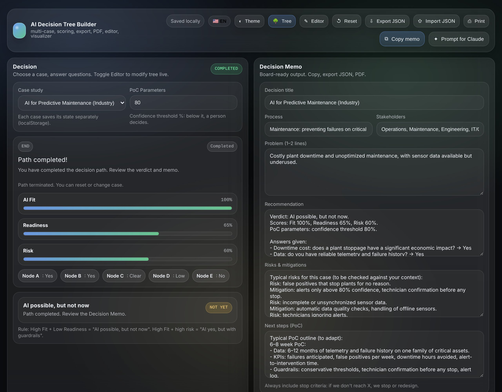

**AI Decision Tree Builder**
🌍 Live demo: https://surfab.github.io/ai-decision-tree/

AI Decision Tree Builder is a single-page HTML/CSS/JS app to evaluate **if**, **when**, **and how to adopt AI** across different business processes, using guided decision trees and structured scoring ( **Fit/Readiness/Risk** ).

**Key Features**

* **Multi-use-case:** 3 built-in cases (email triage, HR screening, predictive maintenance), easily extensible.
* **Numeric scoring**: Progressive calculation of Fit, Readiness, and Risk along the decision path.
* 	**Node editor**: Live editing of the tree (texts, choices, scores, connections): add, duplicate, delete and jump to nodes. Edits are saved per case and can be reverted to the original tree.
* 	**Offline-first**: Runs entirely locally in a single file, index.html, with persistence via localStorage.
* 	**Decision Memo**: Generates a board-ready memo including problem statement, recommendation, risks, and next steps, with case-specific content (email triage, HR, maintenance).
* 	**JSON export/import**: Snapshot of state and tree (including editor changes), versionable in Git.
* 	**Tree visualization**: Interactive graphical view of the decision tree, with the current path highlighted.
* 	**Print / PDF**: Layout optimized for printing or saving as PDF.
* 	**Prompt for Claude**: Opens claude.ai in a new tab with a ready-made prompt (case, path, scores, outcome), also copied to the clipboard, so Claude writes a memo grounded only in your answers. No API key needed.
* 	**Italian / English**: Questions, choices, verdicts and the Decision Memo switch language with the IT/EN toggle. Trees you edited keep the text you wrote.

**How to Use**

1. Clone the repository or download index.html.
1. Open the file in a modern browser (Chrome, Edge, Firefox, Safari).
1. 	Select a **case study** from the top-left menu.
1. 	Answer the questions by following the decision tree.
1. 	Review:
 
a) Fit / Readiness / Risk **scores**

b) The suggested verdict

c) The generated Decision Memo

>>> Use the Editor to adapt the tree to your context (nodes, copy, weights, outcomes). 

**How the Verdict Works**

* While you answer, the verdict is a provisional estimate from the Fit / Readiness / Risk scores.
* Once the path ends, the outcome reached in the tree decides the verdict: `END_GO` → GO, `END_NOT_YET` → NOT YET, `END_RISKY` → caution, `END_RULES` / `END_NO` → NO.
* A GO reached with Risk above 60% becomes "AI yes, but with strong guardrails".

**Fixed memo vs. Claude memo (real example)**

Case: predictive maintenance. Path: downtime is costly → **Yes**, reliable telemetry and failure history → **Yes**, what happens when an alert fires → **Unclear**. Outcome: **NOT YET** (Fit 70%, Readiness 45%, Risk 45%).

| | Built-in memo (text per verdict) | Memo written by Claude via "Prompt for Claude" |
|---|---|---|
| Recommendation | *"Before AI: clean up telemetry and failure history, define the alert → ticket → intervention workflow."* | *"Don't start a full AI project now. First define what happens when an alert arrives, then run a limited PoC on one critical asset at an 80% confidence threshold."* |
| Tied to the answers? | No: it asks to clean up data the user just said is reliable | Yes: one point per answer, and it names the unclear alert workflow as the reason Readiness is at 45% |
| Missing data | Not flagged | Marked "to be verified": cost per hour of downtime, failure baseline, acceptable false-alarm rate |

The built-in memo is the same for every path that ends in the same verdict. The Claude memo follows the path, and the prompt's rules keep it from inventing numbers. The example memo was written in Italian; quotes are translated.

**Who It’s For**

* 	**Founders**, **C-level executives**, and **function heads** deciding where AI actually makes sense.
* 	**Innovation**, **digital**, and **data teams** looking for a repeatable framework to assess AI use cases.
* 	**Consultants** who want a lightweight, offline, demo-friendly tool to use with clients.

**Roadmap (Future Ideas)**

* Path history and comparison across multiple use cases.
* Full undo/redo for decisions.
* Export tree as an image (PNG/SVG) for slides.
* New vertical templates (finance, retail, healthcare, etc.)

**Changelog**

* **October 2026 (3)**: "Prompt for Claude" button (IT/EN); no more horizontal scroll on phones.
* **October 2026 (2)**: full English version of the three trees, verdicts, memo and messages.
* **October 2026**: the verdict follows the path outcome (it could show GO on a "not yet" path); working node editor buttons (add, duplicate, delete, go to node) and saved edits; JSON import fixed; case-specific memo for HR and maintenance; fixes to the IT/EN toggle and to memo persistence on reload.

**License**

MIT
